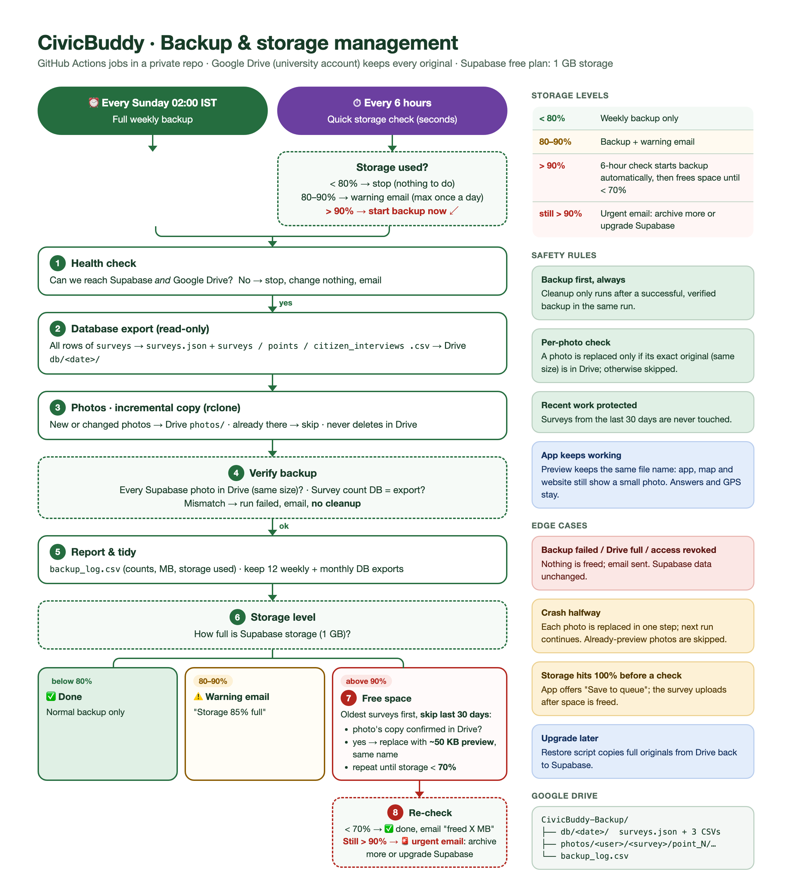

# CivicBuddy · Backup & storage management

> **Status:** approved. **Phase 1: backup** is being rolled out; freeing space
> (step 7) stays **off** (`FREE_SPACE=0`) until the backup has run successfully.
> How to run it: [section 9](#9-how-to-run).

CivicBuddy stores survey data and photos in **Supabase (free plan, 1 GB storage)**.
Photos take almost all of that space: about 1.2 MB each, so roughly 50 MB per
survey. This plan:

1. **backs up** everything to Google Drive (university account, 1 TB), and
2. **keeps Supabase below its limit** automatically, without breaking the app,
   the map or the website.



---

## 1. Triggers

The job runs on GitHub Actions in a **private** repository.

| Trigger | Schedule | What it starts |
|---|---|---|
| **Weekly backup** (green) | Every Sunday 02:00 IST | The full backup (steps 1–8) |
| **Storage check** (purple) | Every 6 hours, takes seconds | Only checks how full Supabase storage is (see below) |
| Manual | "Run workflow" button on GitHub | Either mode, optionally as a **dry run** that changes nothing |

**What the 6-hour storage check does:**

| Storage used | Action |
|---|---|
| below 80% | Nothing |
| 80–90% | Warning email (at most once a day) |
| above 90% | **Starts the full backup immediately**, which then frees space |

Supabase's free plan cannot send an alert the moment storage reaches 90%, so
the 6-hour check is how "automatic" is achieved: the job reacts within 6 hours
at most.

---

## 2. The backup, step by step

| Step | Name | What happens | If it fails |
|---|---|---|---|
| 1 | **Health check** | Can the job reach Supabase **and** Google Drive? | Stop, change nothing, email |
| 2 | **Database export** (read-only) | All rows of the `surveys` table → `surveys.json` (exact copy) + `surveys.csv`, `points.csv`, `citizen_interviews.csv` → Drive `db/<date>/` | Stop, email |
| 3 | **Photos: incremental copy** | Compares Supabase's `survey-photos` bucket with Drive. Photos already in Drive (same size) are skipped; only **new or changed** photos are copied. Nothing is ever deleted in Drive. | Stop, email |
| 4 | **Verify backup** | Is every Supabase photo in Drive with the same size? Does the export contain every survey? | Run marked failed, email, **no cleanup**. The next run fills the gaps. |
| 5 | **Report & tidy** | Adds a line to `backup_log.csv` (date, surveys, photos, MB copied, storage used). Keeps the last 12 weekly database exports plus one per month forever. Photos are never pruned. | |
| 6 | **Storage level** | How full is Supabase storage (1 GB)? Three branches, see below. | |

### Step 6: three branches

| Storage used | Result |
|---|---|
| **below 80%** | ✅ Done. Normal backup only. |
| **80–90%** | ⚠️ Warning email: "Storage 85% full". |
| **above 90%** | → **Step 7: free space** |

### Step 7: free space (only above 90%)

- Works through the **oldest surveys first**.
- **Never touches surveys from the last 30 days.**
- For each full-size photo:
  1. Is its original confirmed in Drive (same size)? If not, the photo is **skipped**.
  2. If yes, the photo in Supabase is replaced by a **~50 KB preview with the same file name**. The preview is made from the Drive copy, so freeing space doesn't use Supabase's free download allowance.
- Stops as soon as storage is **below 70%**.

### Step 8: re-check

| After freeing | Result |
|---|---|
| below 70% | ✅ Done. The freed amount is recorded in `backup_log.csv` (no email: GitHub only emails when a run fails or warns). |
| **still above 90%** | 🚨 **Urgent email:** archive more surveys or upgrade Supabase |

---

## 3. Storage levels (summary)

| Supabase storage | Action (automatic) |
|---|---|
| **< 80%** | Weekly backup only |
| **80–90%** | Backup + warning email |
| **> 90%** | The 6-hour check starts the backup automatically, then frees space until < 70% |
| **still > 90%** | Urgent email: archive more or upgrade Supabase |

---

## 4. Safety rules

| Rule | Meaning |
|---|---|
| **Backup first, always** | Space is only freed after a **successful, verified** backup in the same run. |
| **Per-photo check** | A photo is replaced only if its exact original (same size) is in Drive; otherwise it's skipped. |
| **Recent work protected** | Surveys from the last 30 days are never touched. |
| **App keeps working** | A preview keeps the same file name, so the app, map and website still show a (smaller) photo. Survey answers and GPS are never changed. |
| **Nothing deleted in Drive** | Full-size originals in Drive are kept forever. |
| **Read-only, except previews** | The only thing the job ever changes in Supabase is replacing an old photo with its preview. |

---

## 5. Edge cases

| Situation | What happens |
|---|---|
| **Backup failed / Drive full / Drive access revoked** | Nothing is freed; email sent. Supabase data unchanged. |
| **Crash halfway** | Each photo is replaced in one step, so no photo is ever half-written. The next run continues; photos already replaced by previews are skipped. |
| **A photo was uploaded after the backup** | It isn't in Drive yet, so it's skipped by the cleanup and backed up next run. |
| **App uploads during the cleanup** | No conflict: only surveys older than 30 days are cleaned. |
| **Storage hits 100% before a check** | The app offers **"Save to queue"**; the survey uploads once space is freed. |
| **Website download of an old survey** | Its photos are the smaller previews; the originals are in Google Drive. |
| **Upgrading Supabase later** | A restore script copies the full originals from Drive back to Supabase. |
| **Database size (500 MB free limit)** | Survey data without photos is tiny (12 surveys < 1 MB), so this limit is years away. Only photos need managing. |

---

## 6. Google Drive layout

```
CivicBuddy-Backup/
├── db/
│   ├── 2026-11-23/   surveys.json, surveys.csv, points.csv, citizen_interviews.csv
│   └── 2026-11-30/   …
├── photos/
│   └── <user>/<survey>/point_N/photo_N.jpg     full-size originals, never deleted
├── backup_log.csv    one line per run
└── state.json        which photos were replaced by previews (+ original size)
```

---

## 7. Tools and access

| Part | Tool | Access |
|---|---|---|
| Scheduler | GitHub Actions (private repository) | Free: about 125 minutes/month of the 2,000 included |
| Supabase | Supabase REST + Storage API | Service-role key, stored only as a GitHub secret |
| Google Drive | **rclone**, a command-line tool that copies files to and from cloud storage | Remote `unidrive`, permission `drive.file`: rclone can only see the files it created itself, not the rest of the Drive |

**Secrets** (GitHub → Settings → Secrets and variables → Actions):

| Secret | Value |
|---|---|
| `SUPABASE_URL` | already exists (used by app releases) |
| `BACKUP_SUPABASE_SERVICE_ROLE_KEY` | Supabase → Project Settings → API Keys → `service_role` (or secret) key |
| `RCLONE_CONF` | the whole contents of `~/.config/rclone/rclone.conf` (remote `unidrive`) |

Never commit or share them. The app repository is public, so the job logs
only counts and sizes, never file paths or survey content.

---

## 8. Rollout after approval

1. **Dry run on a Mac:** reads everything and shows what it would do; changes nothing.
2. **First real backup:** copies everything (about 612 MB the first time).
3. **Private GitHub repository + secrets:** the weekly and 6-hour schedules start.
4. **Watch the first runs** in `backup_log.csv`.

---

## 9. How to run

**Files**

| File | Purpose |
|---|---|
| `backup.py` | The whole flow (steps 1–8) |
| `requirements.txt` | Python packages: `requests`, `pillow` |
| `run_local.sh` | Run on a Mac with `.env` and the local rclone remote |
| `.env.example` → `.env` | Local secrets (git-ignored) |
| `../.github/workflows/backup.yml` | GitHub schedule: Sunday 02:00 IST + every 6 hours |

**On a Mac**

```sh
cd BackUp
python3 -m venv .venv && .venv/bin/pip install -r requirements.txt   # once
cp .env.example .env      # then fill in .env (never commit it)
DRY_RUN=1 ./run_local.sh weekly    # test: reads everything, changes nothing
./run_local.sh weekly              # real backup
./run_local.sh check               # storage check
```

**On GitHub:** Actions → *CivicBuddy backup* → *Run workflow* → choose
`weekly` or `check`, tick *Dry run* to test.

**Turning on freeing space (phase 2):** Settings → Secrets and variables →
Actions → *Variables* → new variable `FREE_SPACE` = `1`.

**Note:** GitHub pauses scheduled workflows in a repository with no commits
for 60 days, and emails before it does. Any commit, or re-enabling the
workflow in the Actions tab, restarts it.
